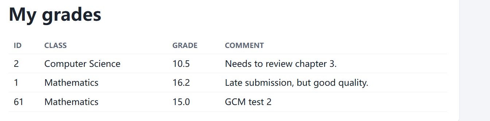
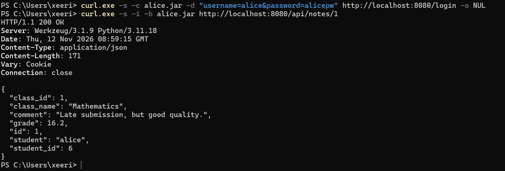
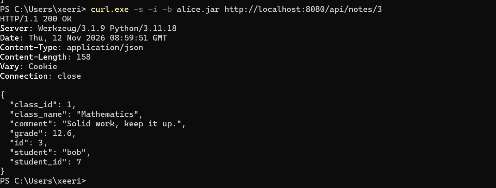
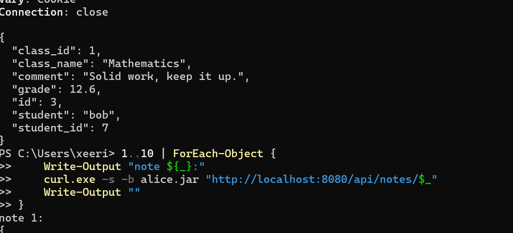
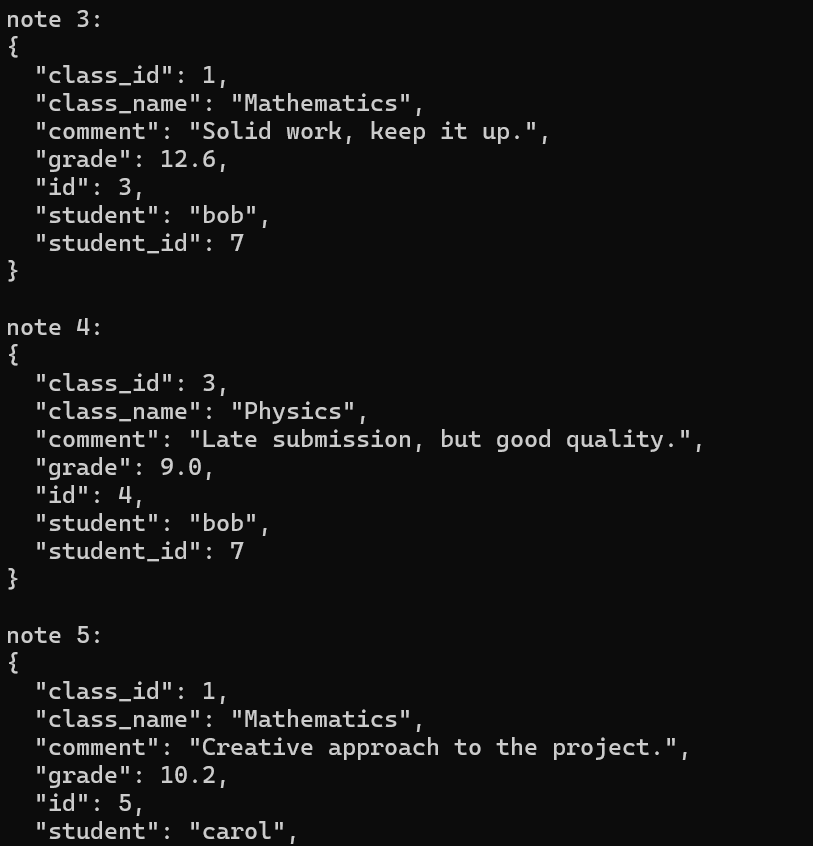
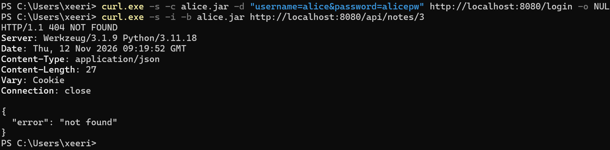
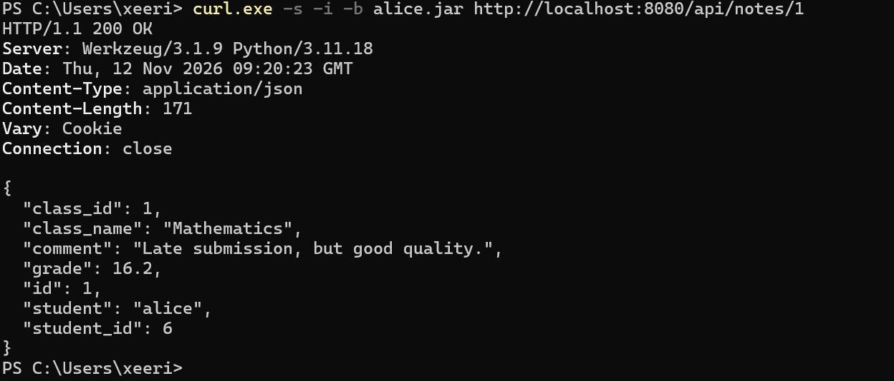

# NotesApp Lab Report: IDOR Reproduction and Fix

**Lab:** Read anyone's grade, then lock the door  
**Vulnerability:** NotesApp flaw #7 — Broken Access Control / IDOR  
**Date:** 12 November 2026  
**Environment:** Windows PowerShell, Docker, and a local NotesApp instance at `http://localhost:8080`  
**Scope:** Only my own local NotesApp clone and its simulated seed data.

## 1. Submission Summary

| Requirement | Result |
| --- | --- |
| Proof I got in | As Alice, requesting `/api/notes/3` returned `200 OK` and Bob's grade **12.6**, with the comment **Solid work, keep it up.** |
| Fix | Check ownership in `api_notes` before returning the note. Deny access when `student_id` differs from the caller's `user_id`, unless the caller is a teacher or admin. |
| Response code chosen | **404 Not Found** |
| Proof the cross-student request is blocked | After the fix, Alice's request to `/api/notes/3` returned `404 NOT FOUND` and `{"error":"not found"}`. |
| Owner access preserved | Alice's request to `/api/notes/1` returned `200 OK` and her grade **16.2**. |
| Teacher access preserved | `prof.turing`'s request to `/api/notes/3` returned `200 OK` and Bob's grade **12.6**. |

The response results above are supported by the screenshots below. Teacher access was tested; the admin exception is included in the fix logic but was not independently tested in the supplied evidence.

## 2. Prediction Before Testing

My prediction was that, after Alice logged in, requesting `/api/notes/3` would return Bob's grade and comment if the server checked only authentication and did not check ownership.

Alice's dashboard displayed her own grades. A student should be allowed to read their own records, but changing a record ID in the URL should not grant access to another student's records.



## 3. Reproducing the Vulnerability

### 3.1 Log in as Alice and read her own note

I logged in from PowerShell and saved Alice's session cookie:

```powershell
curl.exe -s -c alice.jar -d "username=alice&password=alicepw" http://localhost:8080/login -o NUL
```

I then requested Alice's own note:

```powershell
curl.exe -s -i -b alice.jar http://localhost:8080/api/notes/1
```

The server returned `HTTP/1.1 200 OK`. The response identified the owner as `alice`, with `student_id` equal to `6` and a grade of `16.2`.


### 3.2 Change the ID and read Bob's note

Using the same Alice session, I changed only the note ID from `1` to `3`:

```powershell
curl.exe -s -i -b alice.jar http://localhost:8080/api/notes/3
```

The actual response was:

```http
HTTP/1.1 200 OK
```

```json
{
  "class_id": 1,
  "class_name": "Mathematics",
  "comment": "Solid work, keep it up.",
  "grade": 12.6,
  "id": 3,
  "student": "bob",
  "student_id": 7
}
```

| Field | Observed value |
| --- | --- |
| Authenticated user | alice |
| Requested endpoint | `/api/notes/3` |
| HTTP status | 200 OK |
| Record owner | bob |
| Owner's user ID | 7 |
| Grade | 12.6 |
| Comment | Solid work, keep it up. |

This confirmed my prediction. Alice was authenticated, but the API returned a record belonging to Bob without enforcing ownership.



### 3.3 Enumerate the local seed records

I used the following PowerShell loop to request IDs `1` through `10` in the local lab:

```powershell
1..10 | ForEach-Object {
    Write-Output "note ${_}:"
    curl.exe -s -b alice.jar "http://localhost:8080/api/notes/$_"
    Write-Output ""
}
```

The captured output shows Bob's note `4`, with a grade of `9.0`, and Carol's note `5`, with a grade of `10.2`. This demonstrates that the missing authorization check affected more than note `3`.





## 4. Root Cause

This vulnerability is an **Insecure Direct Object Reference (IDOR)** caused by missing object-level authorization.

The endpoint `/api/notes/<id>` uses a number supplied in the URL to locate a grade record. In the original handler shown in the lab, the server checks whether the user is logged in and whether the record exists. It does not check whether the authenticated user is allowed to read that record.

These are separate security questions:

- **Authentication:** Who is making the request? In this case, Alice.
- **Authorization:** Is that user allowed to read this particular record?

Alice's user ID is `6`, while Bob's note has `student_id = 7`. For a student request, the server must compare the note's `student_id` with the authenticated caller's `user_id`. The note's own `id` identifies the record and must not be confused with its owner's user ID.

## 5. Fix

**File:** `web/app.py`  
**Handler:** `api_notes(note_id)`

The ownership check belongs immediately after fetching the note and checking that it exists, before converting or returning the grade. The original authentication and database query must be retained.

The required core fix is:

```python
    note = cur.fetchone()
    if not note:
        return jsonify({"error": "not found"}), 404

    # Students may only read their own notes.
    # Teachers and admins may read any note.
    if (
        note["student_id"] != ident["user_id"]
        and ident.get("role") not in ("teacher", "admin")
    ):
        return jsonify({"error": "not found"}), 404

    note["grade"] = float(note["grade"]) if note["grade"] is not None else None
    return jsonify(note)
```

This is the relevant handler excerpt, rather than the complete function. The complete modified `web/app.py`, including its existing route, authentication, and database query, must accompany the submission. The response behavior is verified by the supplied screenshots; the actual project source was not provided for direct inspection when preparing this report.

The resulting access rules are:

| Caller | Access |
| --- | --- |
| Record owner | Allowed |
| Another student | Denied with 404 |
| Teacher | Allowed |
| Admin | Allowed |

### Why I chose 404

I chose **404 Not Found** for a record the caller is not allowed to read. Returning the same error as a nonexistent record avoids directly confirming that the requested ID exists. A `403 Forbidden` response would block access too, but would explicitly distinguish a forbidden record from a missing one. This choice reduces information disclosure through the response; it does not guarantee the absence of every possible side channel.

## 6. Verification After the Fix

After applying the source change, the application should be rebuilt before repeating the requests:

```powershell
docker compose up -d --build
```

### 6.1 Alice requests Bob's note: denied

```powershell
curl.exe -s -c alice.jar -d "username=alice&password=alicepw" http://localhost:8080/login -o NUL
curl.exe -s -i -b alice.jar http://localhost:8080/api/notes/3
```

The captured response was:

```http
HTTP/1.1 404 NOT FOUND
```

```json
{
  "error": "not found"
}
```

The same request that previously exposed Bob's grade no longer returned his grade or comment.



### 6.2 Alice requests her own note: allowed

```powershell
curl.exe -s -i -b alice.jar http://localhost:8080/api/notes/1
```

The server returned `HTTP/1.1 200 OK` with Alice's Mathematics record:

- Owner: `alice`, with `student_id = 6`.
- Grade: `16.2`.
- Comment: `Late submission, but good quality.`

This confirms that the fix preserved the owner's legitimate access.



### 6.3 A teacher requests Bob's note: allowed

```powershell
curl.exe -s -c prof.jar -d "username=prof.turing&password=teach123" http://localhost:8080/login -o NUL
curl.exe -s -i -b prof.jar http://localhost:8080/api/notes/3
```

The server returned `HTTP/1.1 200 OK` with Bob's grade `12.6` and comment `Solid work, keep it up.` This confirms that the teacher's legitimate access was preserved.



### 6.4 Test results

| Stage | Caller | Request | Actual HTTP status | Actual result |
| --- | --- | --- | --- | --- |
| Before fix | alice | `/api/notes/1` | 200 | Alice's grade: 16.2 |
| Before fix | alice | `/api/notes/3` | 200 | Unauthorized disclosure of Bob's grade: 12.6 |
| After fix | alice | `/api/notes/3` | 404 | `{"error":"not found"}` |
| After fix | alice | `/api/notes/1` | 200 | Alice's grade: 16.2 |
| After fix | prof.turing | `/api/notes/3` | 200 | Bob's grade: 12.6 |

## 7. Conclusion

Before the fix, Alice could read another student's grade by changing a number in the request URL. After the fix, the same cross-student request returned 404, while Alice could still read her own record and the teacher could still read Bob's record.

The lesson is that a valid session establishes identity, but access to each object still requires a server-side authorization check. Endpoints that retrieve grades, invoices, messages, or orders by ID must enforce the appropriate ownership or role rules for every request.

## 8. Source Submission and Cleanup

The lab also requires committing the modified `web/app.py`. No Git commit evidence was supplied with the screenshots, so the source commit must be confirmed separately in the actual project.

Review and commit the modified source from the project directory:

```powershell
git diff -- web/app.py
git add web/app.py
git commit -m "Fix IDOR in notes API with ownership check"
```

Do not commit session cookie files such as `alice.jar` or `prof.jar`.

After the lab, stop the application while retaining its data volume:

```powershell
docker compose down
```
